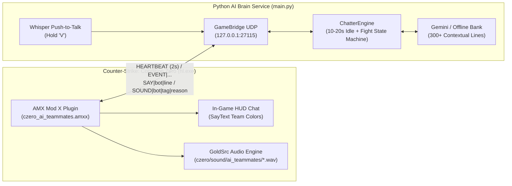

# Counter-Strike: Condition Zero — AI Teammates Mod

> **"Playing Condition Zero with 4 friends who are always online."**

A complete AI Teammates & Context-Aware In-Game Sound Pack integration for **Counter-Strike: Condition Zero (GoldSrc)**. Standard Condition Zero bots are transformed into living, reactive teammates (**Vikram**, **Kabir**, **Marcus**, and **Sunny**) who banter in team-colored on-screen HUD chat, react within 1–2 seconds to kills, deaths, headshots, bomb plants/defuses, and round outcomes, argue with each other mid-match, respond to your text chat or microphone (`V` push-to-talk), and trigger attributed meme sounds natively inside the GoldSrc audio engine.

---

## ✨ Key Features

### 1. Four Distinct Teammate Personalities
- **Vikram (The Hothead)** — Aggressive entry fragger. Hypes up multi-kills, demands immediate refrags, and tilts when picked off by an AWP.
- **Kabir (The Jokester)** — Witty roaster and comic relief. Roasts missed sprays, blames 2004 hitreg, and starts banter fights with teammates.
- **Marcus (The Calm Pro)** — Composed veteran tactician. Gives crisp callouts, coordinates crossfires, and keeps comms disciplined during clutches.
- **Sunny (The Enthusiastic Rookie)** — Nervous, eager support player. Asks economy questions, panics when the bomb beeps fast, and celebrates every round win.

### 2. Native On-Screen HUD Chat (`SayText` / Team Colors)
- Bot messages render directly on the Counter-Strike HUD chat using native GoldSrc `SayText` team coloring (**Blue** for Counter-Terrorists, **Red** for Terrorists).
- Works regardless of whether the speaking bot or player is alive or dead.
- Automatically sanitizes formatting characters (`%`) and respects the GoldSrc 190-character HUD buffer limit.

### 3. In-Engine GoldSrc WAV Sound System with Full Attribution
- **78 Curated Meme & Reaction Sounds** across **19 Tags** (`hype`, `kill_headshot`, `shock`, `praise`, `roast`, `hindi_swear`, `fail_sad`, `apology_getup`, `shut_up`, `greeting`, `laugh`, `goodbye`, etc.), pre-converted to **16-bit PCM mono WAV at 22050 Hz** inside `czero/sound/ai_teammates/<tag>/`.
- Played natively inside the GoldSrc engine (`spk "ai_teammates/<tag>/<file>.wav"`) — **zero external audio players**.
- **Anti-Repeat & Cooldown Protection**:
  - The AI Brain dispatches only a semantic sound **tag**; the AMX Mod X plugin selects a random `.wav` from that tag and guarantees the same file is never picked twice in a row.
  - Enforces a **3.0s global cooldown** and **8.0s per-tag cooldown** so sounds never overlap or spam.
- **On-Screen Attribution**: Every sound prints colored attribution in chat showing who played it, a readable sound name, and why:
  ```text
  [SOUND] Vikram played "sad trombone" (triggered by Opie's death)
  ```

### 4. Lifecycle-Coupled AI Brain (2s Heartbeat + Process Watchdog)
- **Never Runs Alone**: The AI Brain (`main.py`) stays strictly idle until the in-game AMX Mod X plugin connects.
- **2-Second Heartbeat**: The plugin sends `HEARTBEAT|alive` every 2.0 seconds over localhost UDP (`127.0.0.1:27115`). If no heartbeat arrives for 10 seconds, the Brain stops all timers, clears its queue, and goes idle.
- **Instant Shutdown on Game Exit**: When you close `hl.exe`, the plugin sends `stopsound` + `GOODBYE|shutdown` and the Win32 process watchdog shuts the Brain down completely within **< 3 seconds**.
- **Dual-Layer Reliability**: Works with Google Gemini (`gemini-2.5-flash`), OpenRouter, or **100% offline** via the built-in 300+ line context-aware dialogue bank (`brain/offline_bank.py`) and in-plugin fallback banks.

---

## 🏗️ Architecture



---

## 🚀 Quick Start

### Prerequisites
- **OS**: Windows 10 / 11
- **Python**: Python 3.10+ (`py` launcher on `PATH`)

### Option A: Open `hl.exe` Directly (Recommended)
1. Optional: Start the lightweight game watcher in a terminal so the Python AI Brain starts and stops automatically whenever you open or close `hl.exe`:
   ```powershell
   py hl_watcher.py
   ```
2. Open **`hl.exe`**, click **Change Game -> Counter-Strike: Condition Zero**, and start a New Game with bots.
3. Even if Python is not running, the compiled in-game AMX Mod X plugin (`czero_ai_teammates.amxx`) automatically runs idle chatter every 10–20 seconds and triggers kill/death/bomb/round sound reactions inside the game.

### Option B: Launch via Batch Script or CLI
Double-click **`play_czero.bat`** or run:
```powershell
py main.py --launch-game
```
To configure your own optional Gemini / OpenRouter API key, copy `config.example.json` to `config.json` (or use the Web Dashboard at `http://localhost:5000` when running `py main.py`).

---

## 🎮 In-Game Console & Chat Commands

### Console Commands (`~`)
| Command | Description |
| :--- | :--- |
| `ai_status` | Displays plugin load status, Brain connection (`2s Heartbeat`), AI model, queue size, and fight state in console and chat. |
| `ai_test_say` | Makes a teammate bot immediately say a test line in team-colored on-screen HUD chat. |
| `ai_test_sound <tag>` | Plays a random `.wav` from `<tag>` in-game with `[SOUND]` chat attribution. |
| `ai_sound_list` | Lists all 19 sound tags and the number of `.wav` files loaded in each. |
| `ai_sound_menu` | Opens the interactive in-game AMX Mod X Voice Pack menu (`1`–`9`). |
| `ai_force_chat` | Immediately triggers the next bot idle banter line on screen. |
| `ai_force_fight` | Starts a multi-turn argument between two bots (e.g., `Vikram` vs `Kabir`). |
| `ai_reset` | Clears the chatter queue and resets active bot arguments. |

### Player Chat Triggers (`Y` or `U`)
- Type anything in normal chat (e.g., `rush b`, `need help`, `save guns`, `hello`) and a teammate bot will reply in chat and execute matching bot radio orders.
- Quick sound commands in chat: `!sounds` (opens sound menu), `!sound <tag>`, `!hype`, `!headshot`, `!shock`, `!praise`, `!roast`, `!rage`, `!sad`, `!sorry`, `!shutup`, `!hello`, `!laugh`, `!bye`.

---

## 🧪 Running the Verification Suite

Run the automated end-to-end verification suite covering all 6 core requirements (idle state when game closed, 2s heartbeat & `ai_test_say`, bot death reaction `< 2s` with 16-bit 22050 Hz mono WAVs & cooldowns, immediate shutdown `< 5s` on game close, 10–20s idle chatter without standalone timer sounds, and `< 3%` FPS/CPU overhead):

```powershell
py -u tests/test_all_requirements.py
```

### Recompiling the AMX Mod X Plugin (Optional)
If you edit `czero/addons/amxmodx/scripting/czero_ai_teammates.sma`, recompile it with the included Pawn compiler:
```powershell
cd czero\addons\amxmodx\scripting
.\amxxpc.exe czero_ai_teammates.sma -o"..\plugins\czero_ai_teammates.amxx"
```

---

## 📁 Repository Structure

```text
├── brain/                  # AI Brain service, ChatterEngine, OfflineBank, Mood & Memory managers
├── czero/                  # Condition Zero mod directory, Metamod, AMX Mod X plugin & 22050Hz WAVs
│   ├── addons/amxmodx/
│   │   ├── plugins/czero_ai_teammates.amxx
│   │   └── scripting/czero_ai_teammates.sma
│   └── sound/ai_teammates/ # 16-bit 22050 Hz mono WAVs organized by tag
├── docs/STATUS.md          # Diagnostic architecture & status report
├── personalities/          # JSON persona definitions (Vikram, Kabir, Marcus, Sunny)
├── plugin/                 # Python UDP GameBridge & auto-installer
├── sounds/                 # Source audio library organized by tag
├── stt/                    # Local Whisper push-to-talk microphone listener
├── tests/                  # Automated verification test suites
├── ui/                     # Local Web Command Center (http://localhost:5000)
├── voice/                  # WAV converter & tag cooldown/anti-repeat manager
├── hl_watcher.py           # Auto-starts/stops Brain when hl.exe opens/closes
├── main.py                 # Main AI Brain entry point
└── play_czero.bat          # One-click game + Brain launcher
```

---

## 📜 License
Released under the [MIT License](LICENSE). For offline single-player and insecure LAN listen-server use only.
